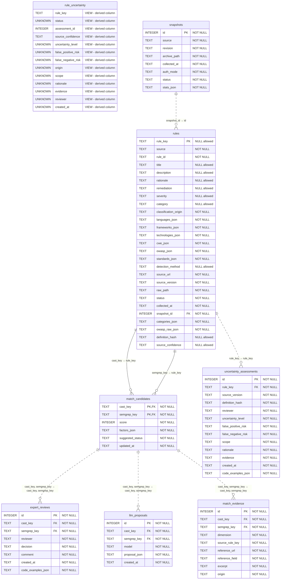

# Modèle de la base de données

Diagramme généré à partir du schéma SQLite. PK : clé primaire ; FK : clé étrangère ; UK : unicité sur une colonne. Les clés composites restent groupées dans les relations. Les vues sont indiquées par VIEW et leurs dépendances ne sont pas inférées.

